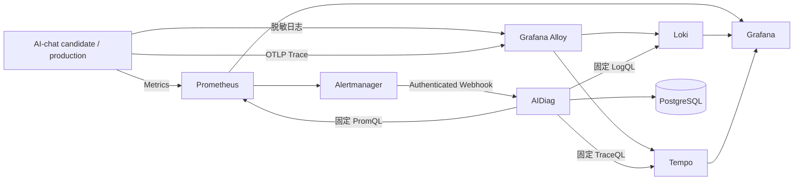

# AIDiag：AI 驱动的智能运维与异常诊断平台

AIDiag 是一个面向 Java 服务的证据驱动型异常诊断平台。它接收 Alertmanager 告警，聚合 Incident，并从 Prometheus、Loki、Tempo 收集固定查询范围内的指标、日志和 Trace 证据，最终生成可审计、可解释的确定性诊断报告。

平台当前重点接入 **AI-chat**：通过私有遥测网络监控候选与按 cutover 激活的生产实例，不侵入 AI-chat 业务代码，也不会把 Prompt、回答、用户 ID、会话 ID 或 Secret 写入运维遥测。

> 当前状态：Stage 0～5.5 已完成，AIDiag / AI-chat V1.0.0 已于 2026-07-14 正式发布。完整发布证据见 [`2026-07-14-v1-production-release.md`](docs/verification/2026-07-14-v1-production-release.md)。

> 当前主域名：Cloudflare Pages 前端使用 `app.dduo.me`，GCP API 使用 `api.dduo.me`。`dduo.chat` 是历史发布域名，只保留迁移参考，不再作为新配置基线。

## V1.1 Incident Casefile Console（本地实现，尚未发布）

- `frontend-console/`：Vue 3 + Vite + TypeScript 的独立只读运维控制台；
- `/api/v1/console/**`：持久化 Session、精确 Origin/CORS、Session 绑定 CSRF 与脱敏投影 API；
- `service-catalog/catalog.yml`：Git 版本化服务目录，候选校验失败时保留 last-known-good；
- `compose.console.yaml`：显式生产激活层，基础 V1 默认不受新增 Secret 影响；
- [`V1.1-console-release-runbook.md`](docs/release/V1.1-console-release-runbook.md)：需要确认后在 GCP 执行的 TLS、Secret、发布与回滚步骤。

本地前端使用 `npm ci && npm run dev` 启动；生产构建使用 `npm run build`，会同时检查初始 JS/CSS gzip 体积门禁。

## 核心能力

- **告警接入与幂等处理**：Alertmanager Webhook 使用 Basic Auth、请求体限制和数据库唯一约束，重复告警不会重复创建任务。
- **Incident 聚合**：按环境、接收器和告警分组聚合生命周期，支持 firing、resolved 和只读查询。
- **持久化任务与租约恢复**：通过 PostgreSQL `FOR UPDATE SKIP LOCKED`、租约、心跳和 fencing token 支持失败重试与进程恢复。
- **多信号证据采集**：使用固定 PromQL、LogQL、TraceQL 查询模板，外部 label 不参与查询拼接。
- **确定性诊断**：只有必要的 Metric 与 Log 证据同时成立时才允许写入主要根因；证据不足时主动弃权。
- **AI 辅助建议**：Stage 4 可由运维人员手动调用 DeepSeek `deepseek-v4-flash`，模型只生成建议，不改写确定性报告，也不执行自动修复。
- **隐私与成本边界**：遥测字段低基数、日志脱敏、模型请求有每日次数、单次输出和数据范围限制。

## 系统关系



AI-chat 与 AIDiag 只通过遥测协议和告警协议连接。AIDiag 故障不会阻断聊天主链，AI-chat 也不依赖 AIDiag 的业务 API。

## 技术栈

| 分类 | 技术与版本 |
|---|---|
| AIDiag 后端 | Java 21、Spring Boot 4.1.0、Spring AI 2.0.0、Maven 3.9.x |
| 数据与任务 | PostgreSQL 18 + pgvector 0.8.5、Flyway、JDBC/JPA |
| 指标与告警 | Prometheus 3.13.1、Alertmanager 0.33.1 |
| 日志与 Trace | Grafana Alloy 1.17.1、Loki 3.7.3、Tempo 3.0.2、OpenTelemetry Java Agent 2.29.0 |
| 可视化 | Grafana 13.1.0 |
| AI-chat production | Java 21、Spring Boot 4.0.7、Spring Cloud 2025.1.2、Spring Cloud Alibaba 2025.1.0.0、Nacos Client 3.1.1、LangChain4j 1.15.1 |
| Nacos 隔离候选 | Nacos Server 3.2.2（tag + digest 双锁定）、独立 MySQL schema、鉴权与最小权限 RBAC |

基础设施镜像在 [`versions.env`](./versions.env) 中同时锁定版本和 digest，避免仅使用浮动 tag。

## 文档导航

| 文档 | 适合解决的问题 |
|---|---|
| [`docs/AIDiag-平台介绍.md`](docs/AIDiag-平台介绍.md) | 先理解平台、组件作用、能力与边界 |
| [`docs/V1-全链路设计与实现.md`](docs/V1-全链路设计与实现.md) | 从 Stage 0 到生产 V1 的完整设计和数据流 |
| [`docs/AIDiag-核心模块.md`](docs/AIDiag-核心模块.md) | 阅读代码、状态机、数据库和关键不变量 |
| [`docs/AI-chat-接入指南.md`](docs/AI-chat-接入指南.md) | AI-chat 指标、日志、Trace、Secret、候选和生产接入 |
| [`docs/其他项目接入指南.md`](docs/其他项目接入指南.md) | 其他服务从可达性到确定性诊断的逐级接入 |
| [`AIDiag-V1-实施方案.md`](./AIDiag-V1-实施方案.md) | 原始范围、门禁、版本与阶段计划 |
| [`云端实施操作手册.md`](./云端实施操作手册.md) | 需要在 GCP 主机执行的命令和回滚边界 |

## 阶段进度

| 阶段 | 状态 | 交付内容 |
|---|---|---|
| Stage 0 | 已完成 | 模块化单体骨架、Flyway、可观测基础设施和端到端 Smoke |
| Stage 1 | 已完成 | 最小 Fault Lab 与受控故障场景 |
| Stage 2 | 已完成 | Webhook 幂等、Incident 聚合、持久化任务、租约恢复 |
| Stage 3 | 已完成 | 固定规则、多信号证据和确定性报告 |
| Stage 4 | 已完成 | DeepSeek 人工触发建议、配额、审计与输出约束 |
| Stage 5.1 | 已完成 | AI-chat 指标、Trace、脱敏日志和隐私测试 |
| Stage 5.2 | 已完成发布 | 四类 AI-chat 规则、Dashboard、自动建单传输验收 |
| Stage 5.3 | 已完成 | 隔离 contract lab、四类证据闭环、恢复、DeepSeek 联动与评测归档 |
| Stage 5.4 | 独立入口已发布 | Blackbox 外部探针、独立 Grafana 故障入口、鉴权只读 API；Admin 为辅助入口 |
| Stage 5.5 | 已完成 | Phase A～D、完整业务回归、DNS、三地域外部监控、30 分钟稳定观察和发布证据归档均通过 |

完整范围、门禁和遗留风险请阅读 [`AIDiag-V1-实施方案.md`](./AIDiag-V1-实施方案.md)。云端人工操作与回滚说明位于 [`云端实施操作手册.md`](./云端实施操作手册.md)。

## 本地构建

本地构建 AIDiag 需要 Java 21：

```bash
./mvnw verify
```

Windows PowerShell：

```powershell
.\mvnw.cmd verify
```

项目使用 Maven Enforcer 限制 Java `[21,22)` 和 Maven `[3.9,4.0)`。云端主机不需要安装宿主机 JDK，Docker 多阶段构建会使用锁定的 Java 21 builder 和 runtime。

## 配置与部署原则

1. 复制 [`.env.cloud.example`](./.env.cloud.example) 为云端私有 `.env.cloud`，不要提交真实环境文件。
2. 所有密码、API Key 和操作员凭据必须放在 `.secrets/` 或等价的云端 Secret 管理设施中。
3. 部署前运行测试、`docker compose config --quiet` 和 `promtool check rules`。
4. 使用不可变 release 目录和原子符号链接切换版本；失败时恢复上一 release。
5. 不直接公开 AIDiag、Grafana、AI-chat management 和 OTLP 端口。
6. 未经隔离验收，不得在真实用户实例注入数据库、中间件或模型故障。

仓库中的 `.gitignore` 已排除 `.env.cloud`、`.secrets/*`、日志、数据库 dump 和构建产物。提交前仍应执行 Secret 扫描，不能只依赖 `.gitignore`。

## AI-chat 首批诊断场景

- 模型流式请求超时；
- R2DBC 连接池获取等待；
- 文档 outbox 积压；
- Elasticsearch / RAG 搜索不可用。

这些规则使用固定查询和明确的实验 Ground Truth。Trace 只作为辅助证据；Tempo 不可用时不能阻断 Metric/Log 基线。Stage 5.3 已证明隔离契约场景 20/20 可完成闭环，但样本窗口重叠且不是实际 MySQL、RabbitMQ、Elasticsearch 或模型 Provider 故障，因此仓库仍不声明生产准确率。

## 安全边界

- 不保存 Prompt、回答、用户/会话标识或原始异常正文；
- 不允许模型生成或提交 PromQL、LogQL、TraceQL 和任意 URL；
- 不执行自动修复，所有 Runbook action 都是受控、只读或需要人工审批的模板；
- Metric 或 Log 缺失时不写主要根因；
- Secret 不进入代码、镜像、日志、诊断报告和 Git 历史；
- 当前项目用于个人展示和受控实验，不应未经安全收紧直接作为生产运维平台。

## 下一步

cutover `20260713-v1-mvp-cutover-1` 已完成 Phase B：旧 JVM 在 Spring/RabbitMQ shutdown hook 中阻塞，按用户明确确认使用 `SIGKILL` 后，PID、8080 监听和 Java 中间件连接均消失；停写证据与 V4 数据库备份已绑定 cutover 并通过 SHA-256 校验。GCP production 已升级至 `20260714-v1.0.0-rag-model-policy-r12`，Flyway V5、登录/刷新、Guest/用户 SSE、知识库上传、OSS、ES9 + IK、RAG、管理端、Prometheus/Loki/Tempo 关联和精确清理均通过；历史发布时的七个 production 目标全部健康，并完成一次真实 `firing -> Incident -> 报告 -> resolved` 恢复周期。当前源码已将生产契约扩展为第八个公网 HTTPS ingress 目标。

V1 已正式发布。2026-07-14 的后续代码审计又收紧了 Webhook 有界读取、告警状态一致性、最终失败状态、Stage 3 查询间续租、告警持久化脱敏、模型输出防泄漏和公网 ingress 探针；这些源码变更在再次发布 GCP 前仍需执行云端 PostgreSQL/Prometheus/Linux lifecycle 门禁。

V1.1 已在本地实现 Session API、只读 Console API、配置驱动 Service Catalog、AIDiag 自监控、
Alertmanager 重启对账代码与独立 `frontend-console`。生产环境仍保持 V1：V9/V10 数据库迁移、TLS 自动续期验证、
Secret 轮换、磁盘留存门禁、旧 release 恢复演练、Fault Lab 重放和 Pages/Nginx 发布均需按照
[`docs/release/V1.1-console-release-runbook.md`](docs/release/V1.1-console-release-runbook.md) 单独确认后执行。
在这些生产门禁完成前，只能称为“V1.1 发布候选”，不能宣称已经上线或具备企业级高可用。

## License

当前仓库尚未添加开源许可证。在许可证确定前，默认保留全部权利。
