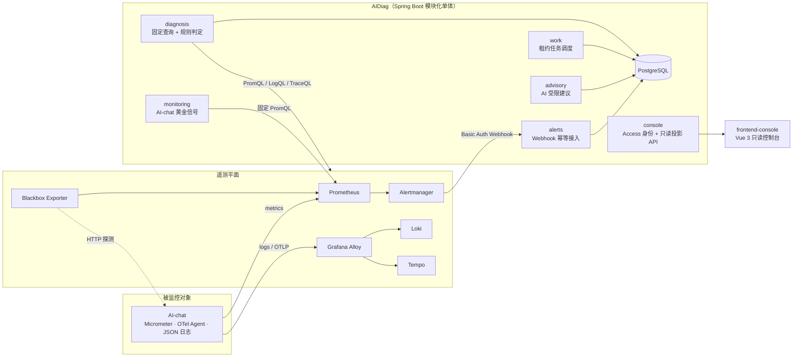

# AIDiag：面向 AI-chat 的可观测与证据驱动诊断平台

AIDiag 以**非侵入**方式监控 AI 对话服务 AI-chat：采集它的指标、脱敏日志和 Trace，在告警触发后自动聚合 Incident、按固定查询收集证据，并生成可审计的确定性诊断报告。AI（DeepSeek）只提供受限建议，不改写结论、不执行修复。

> 状态：V1.0.0 已于 2026-07-14 发布到生产并完成一次真实 `firing → Incident → 报告 → resolved` 周期。V1.1 Console 与本文所述的 AI-chat 信号页、证据曲线、事件趋势为**本地实现，尚未发布**。

## 它解决什么问题

AI-chat 是一个 Spring Cloud + LangChain4j 的流式对话服务，依赖 MySQL、Redis、RabbitMQ、Elasticsearch 和外部模型 Provider。它出问题时通常表现为：

| 现象 | 监控信号 | 告警规则 | 诊断需要的第二证据 |
|---|---|---|---|
| 模型流式超时 | `aichat_chat_requests_total{outcome="timeout"}` | `AiChatModelTimeout` ≥ 1 / 5m | `ai_chat_stream_finished:timeout` 日志 |
| 数据库连接池排队 | `aichat_r2dbc_pool_pending` | `AiChatR2dbcPoolExhaustion` ≥ 1 | `r2dbc_pool_acquire:timeout` 日志 |
| 文档投递积压 | `aichat_document_outbox_pending` | `AiChatDocumentBacklog` ≥ 10 | `document_outbox_dispatch:retry` 日志 |
| 知识检索失败 | `aichat_search_requests_total{outcome="error"}` | `AiChatSearchUnavailable` ≥ 3 / 5m | `knowledge_search:error` 日志 |
| 进程/入口不可达 | Blackbox `probe_success` | `AiChatProcessUnavailable` / `AiChatIngressUnavailable` | 依赖探针 |

另有首 Token 延迟 P95（`aichat_chat_ttft_seconds`）和活跃 SSE 流数作为黄金信号展示。所有指标都是低基数标签，不含 Prompt、回答、用户或会话标识。

## 架构



AI-chat 与 AIDiag 只通过遥测协议和告警协议连接：AIDiag 故障不影响聊天主链，AI-chat 也不调用 AIDiag。

### 一条告警的生命周期

1. **接入**（`alerts`）：Alertmanager 至少一次投递。以 `receiver + groupKey + fingerprint + status + startsAt` 唯一约束做幂等，部分唯一索引保证同一关联键只有一个活动 Incident；原始报文只保留 SHA-256。
2. **调度**（`work`）：诊断任务落库，Worker 用 `FOR UPDATE SKIP LOCKED` + 租约 + 心跳 + fencing token 抢占，进程重启后可恢复、失败按退避重试。
3. **取证**（`diagnosis`）：按告警名匹配规则，只执行服务端固定的 PromQL / LogQL / TraceQL，告警 label 不参与查询拼接。Metric 证据保存降采样后的曲线（≤120 点）以便复核。
4. **判定**：Metric 与 Log 两类独立证据同时成立才写入主要根因；否则报告弃权（`INSUFFICIENT_EVIDENCE`），并写明限制。
5. **建议**（`advisory`，人工触发）：Spring AI 调用 DeepSeek，输入脱敏、输出校验、必须引用已有证据，有每日次数与 Token 预算。
6. **恢复**：`resolved` 关闭 Incident；Alertmanager 重启后由对账 Worker 修正状态漂移。

### 代码模块

| 包 | 职责 |
|---|---|
| `alerts` | Webhook 鉴权、限流、脱敏、幂等入库、告警状态对账 |
| `work` | 诊断任务状态机、租约与重试 |
| `diagnosis` | 规则注册表、遥测取证、确定性报告 |
| `advisory` | AI 建议：Prompt 构造、输出校验、预算、留存清理 |
| `monitoring` | 按服务目录输出固定黄金信号（阈值与告警规则由契约测试锁定一致） |
| `telemetry` | 有界 Prometheus 客户端（超时、响应字节、序列数上限） |
| `catalog` | Git 版本化服务目录、依赖探针汇总、AIDiag 自监控 |
| `console` | Cloudflare Access JWT 校验与浏览器安全投影 API；保留 Session 模式供回滚 |

## 控制台

`frontend-console/` 是 Vue 3 + TypeScript 的只读控制台，暗色“Incident Casefile”风格（见 [`DESIGN.md`](DESIGN.md)、[`PRODUCT.md`](PRODUCT.md)）：

本地新版默认使用 Cloudflare Access + Cloudflare 账号登录，通过 Pages Function 请求同域 API。
后端需启用 Access Compose 覆盖并提供实际 Team domain 与应用 AUD。
接入、真实验收和回滚见 [`docs/Cloudflare-Access-控制台接入.md`](docs/Cloudflare-Access-控制台接入.md)；尚未激活到线上。

- **Inbox**：未恢复事件、待处理诊断任务、处理链路状态，以及最近 14 天事件趋势（按严重程度拆分）。
- **AI-chat**：外部可用性、请求结果分布、首 Token P95、模型超时、SSE 流、R2DBC 排队、Outbox 积压、检索失败；每张图叠加与 Prometheus 规则一致的阈值线，并显示该规则当前 `FIRING / PENDING / INACTIVE`。窗口只能选 1h / 6h / 24h。
- **Incidents / Casefile**：先结论、后证据；Metric 证据显示诊断窗口内的曲线与阈值，Log / Trace 证据与时间线联动。
- **Services**：服务目录与依赖探针，缺样显示 `UNKNOWN` 而不是 0。

图表为手写 SVG（无图表库依赖），支持悬停/键盘逐点读数与数据表视图；首屏 JS gzip ≈ 60 KB。

## 技术栈

| 分类 | 技术 |
|---|---|
| 后端 | Java 21、Spring Boot 4.1、Spring AI 2.0、Flyway、JDBC |
| 存储 | PostgreSQL 18（pgvector 预留，主链不依赖向量检索） |
| 观测 | Prometheus、Alertmanager、Blackbox Exporter、Grafana Alloy、Loki、Tempo、Grafana、OpenTelemetry Java Agent |
| 前端 | Vue 3、TypeScript、Vite、Pinia、Vitest、Playwright |
| 部署 | Docker Compose；镜像在 [`versions.env`](versions.env) 中以 tag + digest 双锁定 |

## 本地开发

```bash
./mvnw verify                     # 后端：Java 21；Testcontainers 用例在无 Docker 时自动跳过
cd frontend-console && npm ci
npm run dev                       # 本地控制台
npm test && npm run test:e2e      # 单元测试与 Playwright（API 已 mock）
npm run build                     # 类型检查 + 构建 + 首屏体积门禁
```

## 仓库导航

| 路径 | 内容 |
|---|---|
| `src/` | AIDiag 后端 |
| `frontend-console/` | 只读运维控制台 |
| `infra/` | Prometheus 规则、Alertmanager、Alloy、Loki、Tempo、Grafana Dashboard |
| `fault-lab/` | 受控故障注入服务与 Ground Truth |
| `deployment/home/` | 家庭服务器 Compose 覆盖与采集脚本 |
| `homeops-console/` | 家庭服务器独立只读概览（与 AIDiag 分开部署） |
| `deploy/` | frontend-console 发布到 Cloudflare Pages |
| `scripts/` | Alertmanager Webhook 鉴权只读校验 |
| `docs/` | 学习与面试资料 |

## 边界与诚实声明

- 不保存 Prompt、回答、用户/会话标识或原始异常正文；模型不能生成查询或 URL。
- 不执行自动修复；Runbook 动作只是需要人工确认的模板。
- 受控 contract lab 场景 20/20 闭环，但并非真实中间件或模型 Provider 故障，因此**不声明生产诊断准确率**。
- 单机部署，Prometheus / Alertmanager / AIDiag 与被监控服务同机时会一起失效，整机故障依赖外部探针发现；不宣称企业级高可用。

## License

尚未添加开源许可证，默认保留全部权利。
