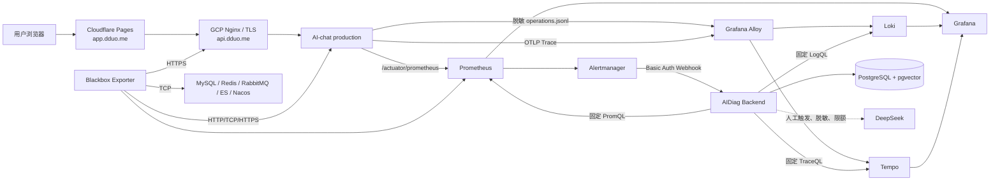
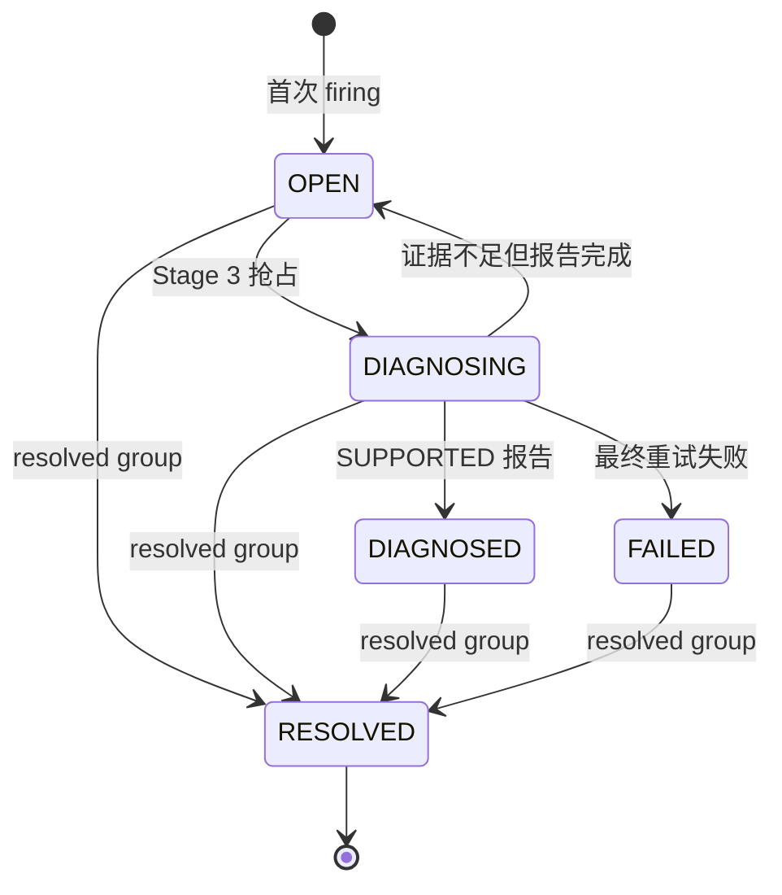

# AIDiag V1 全链路设计与实现

> 文档基线：2026-07-14 代码审计后的 V1 源码。历史生产发布证据见 [`verification/2026-07-14-v1-production-release.md`](verification/2026-07-14-v1-production-release.md)。

## 1. 一句话结论

AIDiag V1 已实现一个“告警进入、事件去重、Incident 聚合、持久化任务、受控取证、确定性诊断、人工 AI 建议、可视化与恢复闭环”的个人展示版运维平台。它不是自动修复系统，也不声称能诊断所有故障；证据不足时主动弃权是 V1 的正确行为。

## 2. 第一性原则

运维平台真正要解决的不是“接一个大模型”，而是以下五个问题：

1. 服务异常时，监控平面仍能发现问题；
2. 同一告警重试时，不能重复建单和重复执行任务；
3. 诊断结论必须能追溯到指标、日志和 Trace 证据；
4. 外部系统超时、进程重启或租约过期时，任务不能丢失或被旧 Worker 覆盖；
5. AI 只能在受控证据范围内提供建议，不能替代确定性结论或自动执行命令。

因此 V1 的主链是“证据驱动的受控诊断闭环”，而不是“LLM 自动运维”。

## 3. 系统边界

### V1 包含

- Prometheus 指标采集与规则告警；
- Alloy、Loki、Tempo 日志和 Trace 链路；
- Alertmanager 分组、去重、路由和 resolved 通知；
- AIDiag Webhook、Incident、持久化任务、租约恢复；
- 固定规则的 PromQL、LogQL、TraceQL 取证；
- PostgreSQL 中的事件、证据、候选根因和报告审计；
- Grafana 独立故障入口；
- Blackbox 对 JVM、依赖端口和生产 HTTPS 入口的独立探测；
- DeepSeek 人工触发的只读建议预览；
- AI-chat 候选、隔离实验和生产接入。

### V1 不包含

- 自动执行修复命令；
- 基于自然语言动态生成 PromQL、LogQL、TraceQL 或 URL；
- Kubernetes、Kafka、多 Agent 编排；
- 跨主机高可用监控集群；
- 对所有未知服务自动推断根因；
- 企业级告警值班、审批、CMDB 和工单系统。

## 4. 总体架构

AI-chat 的聊天主链不调用 AIDiag。AIDiag 故障不会阻断聊天；AI-chat JVM 无法启动时，Blackbox、Prometheus、Alertmanager 和 Grafana 仍可工作。整台 GCP 主机失联时，需要 GCP Uptime Check 等异机监控补充信号。

## 5. 从请求到报告的完整数据流

1. AI-chat 用 Micrometer 暴露低基数指标，用独立 JSON logger 写脱敏运维事件，用 OTel Agent 导出 Trace。
2. Prometheus 抓取指标；Alloy 将日志写入 Loki、将 Trace 写入 Tempo。
3. Blackbox 从应用进程外探测 management health、中间件 TCP 和公网 HTTPS 入口。
4. Prometheus 固定规则达到阈值后，将 firing 告警发送到 Alertmanager。
5. Alertmanager 按 `alertname/service_name/environment` 分组，并通过私有 Basic Auth Webhook 投递 AIDiag。
6. AIDiag 有界读取请求体，校验 label、时间和状态；持久化前递归脱敏，原始 body 只保留 SHA-256 指纹。
7. `alert_event` 唯一约束完成幂等；按 `environment + receiver + groupKey` 的哈希聚合活动 Incident。
8. 首次 firing 原子创建 `diagnosis_run`；Stage 2 Worker 通过 `FOR UPDATE SKIP LOCKED` 抢占任务并完成持久化交接。
9. Stage 3 Worker 使用 owner、lease token、lease generation 和 heartbeat 防止旧 Worker 回写；每次外部遥测查询前都会续租。
10. `DiagnosisRuleRegistry` 只按精确 `(serviceName, alertName)` 选择版本化规则，告警文本不能拼接查询。
11. Prometheus、Loki、Tempo 返回的数据被压缩为有界摘要；只有 Metric 与 Log 两类独立证据同时成立才可产生 `SUPPORTED` 主要根因。
12. 报告、候选、支持/反对证据、工具调用审计在一个事务内写入；租约过期则全部回滚。
13. Alertmanager 发送 resolved 分组后，AIDiag 只在时间顺序安全时将 Incident 置为 `RESOLVED`。
14. 运维人员可手动请求 Stage 4；模型只看到脱敏摘要和允许的 Runbook action，输出仍需本地校验后才能保存为独立建议。

## 6. 状态机与一致性约束

### Incident

### Diagnosis run

`PENDING/RETRY_WAIT → LEASED → COLLECTING → EVIDENCE_READY → ANALYZING → VERIFYING → COMPLETED`。

任一处理阶段失败可进入 `FAILED`，未超过最大次数时创建下一条 `AUTOMATIC_RETRY`。所有写操作均同时校验 run id、owner、lease token 和未过期的 lease；旧 Worker 即使恢复运行也不能覆盖新 Worker 的结果。

## 7. Stage 0～5 的实际演进

| 阶段 | 解决的问题 | 完成边界 |
|---|---|---|
| Stage 0 | 先证明遥测能流动 | Spring Boot 骨架、Flyway、PostgreSQL、Prometheus/Loki/Tempo/Grafana/Alloy、Smoke |
| Stage 1 | 诊断需要可重复 Ground Truth | 隔离 Fault Lab，线程池、Hikari、下游超时、慢查询受控实验 |
| Stage 2 | 告警不能只停留在通知 | Webhook 鉴权、请求上限、幂等事件、Incident 聚合、持久化任务、租约和恢复 |
| Stage 3 | 报告必须有独立证据 | 固定规则、三信号取证、证据摘要、候选根因、主动弃权、不可变报告 |
| Stage 4 | AI 只能做受控增强 | DeepSeek 手动预览、脱敏、超时、每日预算、输出 allowlist、独立审计、无自动修复 |
| Stage 5.1 | AI-chat 先可观测 | Chat/R2DBC/Outbox/Search 指标、Trace、脱敏日志、隐私测试、真实 SSE 验收 |
| Stage 5.2 | AI-chat 进入诊断规则 | 四类固定规则、Dashboard、合成告警自动建单与 resolved 验收 |
| Stage 5.3 | 规则必须可重复评测 | 四类隔离 contract lab 各 5 轮，20/20 完成建单、SUPPORTED 报告和恢复 |
| Stage 5.4 | 应用挂了也能看运维 | Blackbox、独立 Grafana 故障入口、只读 Incident API、Admin 仅作辅助入口 |
| Stage 5.5 | 候选到生产 | Nacos/Elasticsearch+IK 隔离候选、身份晋升、单写切换、回归、DNS/TLS、外部监控 |

## 8. 技术栈与版本策略

| 层 | V1 版本 | 选择依据 |
|---|---|---|
| Java | Temurin 21.0.11+10 | LTS；Maven Enforcer 限定 `[21,22)` |
| AIDiag | Spring Boot 4.1.0 / Spring AI 2.0.0 | Spring AI 2.0 官方支持 Boot 4.0/4.1 |
| API 文档/弹性 | springdoc 3.0.3 / Resilience4j 2.4.0 | 使用 Boot 4 对应 starter |
| 数据 | PostgreSQL 18 + pgvector 0.8.5 | Incident、租约、证据、报告统一事务边界 |
| 指标/告警 | Prometheus 3.13.1 / Alertmanager 0.33.1 | 规则和分组边界清晰 |
| 日志/Trace | Alloy 1.17.1 / Loki 3.7.3 / Tempo 3.0.2 / OTel Agent 2.29.0 | Alloy 统一采集，避免 Metrics/Logs 重复导出 |
| 可视化 | Grafana 13.1.0 | 只使用内置 core panel，禁用后台插件安装 |
| AI-chat | Java 21 / Boot 4.0.7 / Cloud 2025.1.2 / Alibaba 2025.1.0.0 | 由 BOM 管理，避免手工覆盖 Spring 依赖 |
| 服务发现/搜索 | Nacos 3.2.2 / Elasticsearch 9.3.2 + IK 9.3.2 | 候选验证后通过稳定别名晋升 |

版本台账位于 [`../versions.env`](../versions.env)，基础镜像同时固定 tag 和 digest。AIDiag 增加了版本一致性测试，防止 POM、Dockerfile 与台账漂移。Spring Boot 4.1.0 与 Java 要求见[官方系统要求](https://docs.spring.io/spring-boot/system-requirements.html)，Spring AI 2.0 与 Boot 4 的兼容范围见[官方 Getting Started](https://docs.spring.io/spring-ai/reference/getting-started.html)。

## 9. 失败场景如何处理

| 失败 | V1 行为 |
|---|---|
| Webhook 重复投递 | 唯一键阻止重复事件；增加 `receive_count` |
| Webhook 超大或 chunked body | 最多读取配置上限 + 1 byte，超限返回 413 |
| resolved 与内部 alert 状态矛盾 | 返回 400，不关闭 Incident |
| Worker 崩溃 | lease 到期后由其他实例通过 `SKIP LOCKED` 回收 |
| 旧 Worker 恢复 | fencing token 不匹配，任何写入失败 |
| Prometheus/Loki/Tempo 超时 | 保存失败审计；Metric/Log 缺失时不确认根因 |
| Stage 3 查询耗时接近 lease | 每次外部查询前续租；失去 lease 立即停止 |
| 最终重试失败 | run 和活动 Incident 同步进入 `FAILED` |
| 模型不可用或超时 | 返回受控 fallback，确定性报告不变 |
| 模型捏造 evidence/action | allowlist 校验拒绝输出 |
| 模型输出 Secret/邮箱/手机号 | 敏感模式校验拒绝持久化 |
| AI-chat JVM 未启动 | Blackbox、启动失败日志和 Grafana 独立入口仍可使用 |
| DNS/TLS/Nginx 故障 | 公网 HTTPS ingress 探针与内部 JVM 探针可区分故障层次 |

## 10. 发布状态说明

- Cloudflare Pages 前端循环依赖问题已修复并发布；生产构建增加静态 import graph 门禁。
- 2026-07-14 的 AIDiag/AI-chat V1.0.0 已有不可变 release、镜像 digest、SBOM 和稳定性观察证据。
- 本次代码审计新增的 Webhook、租约、隐私和公网探针加固已在本地源码与测试中完成；在用户明确确认前不自动发布到 GCP。
- AI-chat 已移除显式 Tika 2.9.4 覆盖，统一采用 LangChain4j 传递管理的 3.2.3；PDF、DOCX、文本解析回归与全量 `mvn verify` 已通过。该源码变更尚未自动发布到 GCP。

## 11. V1.1 方向

V1.1 优先实现 service catalog 配置驱动：把服务身份、指标契约、固定查询、阈值、Dashboard 和 public probe 从 Java Provider/脚本中抽离到经过 schema 校验和版本审计的配置。届时新增项目的“监控接入”应无需修改 AIDiag Java 代码；涉及新根因语义的“确定性诊断”仍需评审规则和测试样本。

与配置驱动同级的可靠性项包括：Alertmanager 重启后的 firing/resolved 对账、证据不足 Incident 的受控重诊，以及 Incident/证据/报告的归档与保留策略。这些都会改变数据生命周期或状态机，不应在 V1 发布审计中无业务决策地“顺手加上”。
